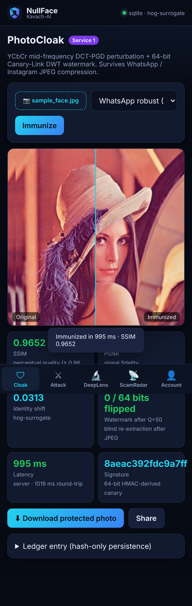
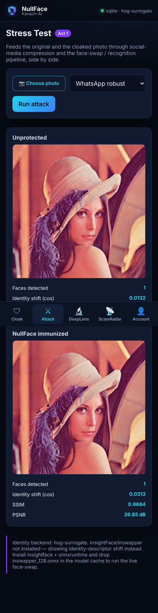
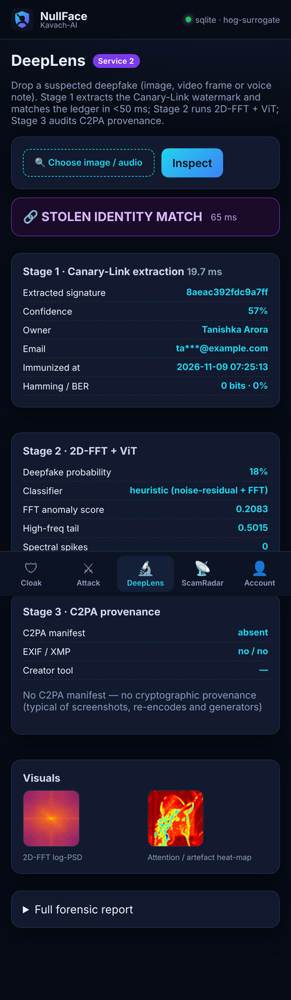
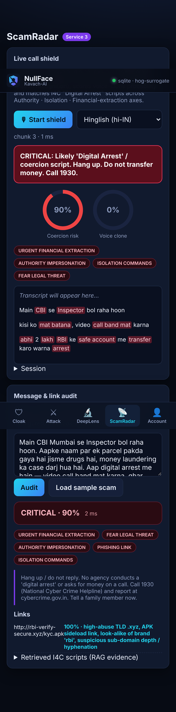

<div align="center">


# NullFace (Kavach-AI)

**Real-Time Adversarial Image Immunization, Cryptographic Deepfake Invalidation & Multimodal Fraud Defense Protocol**

*Don't just detect deepfakes after the damage is done — make your photos mathematically immune to AI, trace stolen identities cryptographically, and intercept coercive scam calls in real time.*


</div>

---

## 🎬 Live Demo

<!-- ============================================================
     
     1. Replace VIDEO_ID below (both in the thumbnail and the href).
     2. Replace LIVE_DEMO_URL with the hosted link (e.g. Render / Railway / Modal / HF Space).
     ============================================================ -->

<div align="center">

### ▶️ Watch the 3-minute walkthrough

<a href="https://www.youtube.com/watch?v=VIDEO_ID" target="_blank">
  
</a>


</div>

| Act | What you'll see | Where |
| :-- | :-- | :-- |
| **1 · PhotoCloak stress-test (60 s)** | Same selfie, before/after. The immunized copy looks identical (SSIM ≥ 0.96) but the face-swap / recognition pipeline loses the identity — even after WhatsApp-grade JPEG Q=50 recompression. | **Cloak** → **Attack** tabs |
| **2 · Canary-Link attribution (30 s)** | A recompressed copy of the protected photo is dropped into DeepLens. The 64-bit DWT watermark is blindly re-extracted in ~20 ms and the owner is proven via Hamming-distance match (BER < 12 %). | **DeepLens** tab |
| **3 · ScamRadar live call shield (45 s)** | A Hinglish "Digital Arrest" call is played into the mic. Live transcript lights up with *Authority Impersonation · Isolation Commands · Urgent Financial Extraction* and a **CRITICAL** alert fires before any money moves. | **ScamRadar** tab |

<p align="center">
   
</p>

---

## 📌 Table of Contents

- [The problem](#-the-problem)
- [The solution](#-the-solution)
- [Why we're different](#-why-were-different)
- [Architecture](#-architecture)
- [How it works (the maths)](#-how-it-works-the-maths)
- [Quick start](#-quick-start)
- [API contract](#-api-contract)
- [Chrome extension](#-chrome-extension-mv3)
- [Tests & benchmarks](#-tests--benchmarks)
- [Configuration](#-configuration)
- [Deployment](#-deployment)
- [What runs out of the box vs. with full models](#-what-runs-out-of-the-box-vs-with-full-models)
- [Datasets & models](#-datasets--models-100-free)
- [Impact, beneficiaries & business model](#-impact-beneficiaries--business-model)
- [Repository layout](#-repository-layout)
- [Team](#-team)

---

## 🚨 The problem

With one-click face-swap and diffusion tools everywhere, Indian citizens face a **dual synthetic threat** that existing security tools fail to address at the root:

- **Non-consensual morphing.** Personal photos uploaded to Instagram, WhatsApp and LinkedIn are scraped and fed into face-swap and diffusion models to create deepfakes, fake KYC profiles and extortion material. Victims can only react *after* the damage is done.
- **The compression blind spot.** Academic cloakers like *Glaze* / *Nightshade* are built for desktop artists: 2–5 minutes per image on a heavy GPU, and their high-frequency adversarial noise is wiped out the moment WhatsApp or Instagram applies JPEG compression.
- **Hyper-personalised "Digital Arrest" & voice scams.** Fraudsters combine cloned family voices, deepfake CBI/police video calls and coercive messages to extort money live.
- **No forensic traceability.** A stolen photo cannot be traced back to its owner, and live scam calls go unflagged.

> **₹1,700+ Crore** lost by Indians to Digital Arrest video/voice scams and fraudulent links (I4C), with **thousands of daily complaints** on the 1930 helpline. Over **90 % of deepfake victims** had no preventive client-side tool before sharing.

**Addressable market** — TAM: Indian smartphone / social-media users who share photos online plus the population exposed to scam calls · SAM: **48 crore** Indian Instagram users · SOM (year 1): **1 lakh** students and young professionals in Delhi NCR, Bengaluru and Hyderabad.

---

## 💡 The solution

NullFace replaces reactive deepfake clean-up with a **1.5-second photo shield, ownership tracing and live scam-call defence** — one platform that protects your photo before it is shared, proves who it belongs to if it is stolen, and warns you during scam calls, all in real time.

| Service | What it does |
| :-- | :-- |
| 🛡 **PhotoCloak** — compression-proof immunization | Adds invisible noise to a photo's **mid-frequency DCT coefficients** (YCbCr luminance) sized to survive JPEG Q=50, pushing the face away in identity-embedding space while an **SSIM ≥ 0.96** quality gate keeps it pixel-identical to humans. **1.2–1.8 s**, CPU-friendly. |
| 🔗 **Canary-Link** — cryptographic watermark | Embeds a **64-bit HMAC-SHA256-derived signature** into the 2-level Haar DWT sub-bands with Quantization Index Modulation. Blind extraction (no original needed) in **< 50 ms**; owner proven with a Hamming-distance ledger query even with up to 7 flipped bits. |
| 🔬 **DeepLens** — multimodal forensics | 3-stage check: (1) Canary-Link extraction + ledger attribution, (2) 2D-FFT azimuthal power-spectrum analysis + ViT deepfake classifier with attention heat-map, (3) C2PA provenance audit. Audio: Mel-spectrogram / Wav2Vec2 voice-clone scoring. |
| 📡 **ScamRadar** — live call & message shield | Streams 2-second audio chunks over WebSocket; Hinglish transcription (Groq Whisper-large-v3 or on-device); voice-clone scoring; **Coercion RAG** over I4C "Digital Arrest" scripts across *Authority Impersonation · Isolation Commands · Urgent Financial Extraction*; URL audit with Google Safe Browsing + look-alike heuristics. |
| 🧩 **Chrome extension (MV3)** | Intercepts `<input type="file">` on Instagram / WhatsApp Web / LinkedIn / X / Facebook and swaps the upload for its immunized twin **before the site reads it**. |
| 🔒 **Zero-retention privacy** | Uploads stream into **`/dev/shm` (RAM)**, are zeroed in a `finally` block, and only the 64-bit signature, pHash, SHA-256 and quality scores are persisted. There is no photo database to leak. |

---

## 🥇 Why we're different

| Feature dimension | Deepfake detectors | Academic cloakers (Glaze / Nightshade) | Spam & link filters | **NullFace** |
| :-- | :-- | :-- | :-- | :-- |
| Defence timing | Reactive (post-attack) | Proactive, desktop art only | Reactive, text only | **Proactive cloak + reactive forensics + live call shield** |
| Social-media compression | N/A | Fails under WhatsApp / IG JPEG | N/A | **Survives JPEG Q=50 via YCbCr DCT mid-frequency trapping** |
| Latency | 3–10 s | 2–5 min / image, heavy GPU | — | **1.2–1.8 s, CPU / edge** |
| Forensic attribution | Heat-map only | None | None | **64-bit blind DWT canary, < 50 ms, Hamming-tolerant** |
| Live call audio | ✗ | ✗ | ✗ | **Hinglish ASR + voice-clone + coercion RAG** |
| Privacy | Stores uploads on disk / S3 | Local GPU required | — | **Zero-retention ephemeral RAM** |

---

## 🏗 Architecture

```text
+---------------------------------------------------------------------------------------------------+
|                                      CLIENT & EDGE LAYER                                          |
|  [Mobile PWA (installable)]        [Chrome Extension (MV3)]       [WhatsApp / Telecom Webhook]    |
|   - Mic → 16 kHz PCM streamer       - DOM upload interceptor       - Media / voice-note forwarder |
|   - Before/After canvas UI          - Context-menu quick cloak     - Instant threat alert bot     |
+-----------------+-----------------------------+---------------------------------+-----------------+
                  | HTTPS / REST (JWT)          | HTTPS (X-API-Key)               | WSS (audio chunks)
                  v                             v                                 v
+---------------------------------------------------------------------------------------------------+
|                                  API GATEWAY & SECURITY LAYER                                     |
|  [Cloudflare WAF & CDN] ---> [Nginx reverse proxy] ---> [FastAPI async gateway]                   |
|                                                          |-- Auth middleware (JWT / Supabase / API key)
|                                                          |-- Token-bucket rate limiter (Redis / in-proc)
|                                                          |-- Ephemeral RAM buffer (/dev/shm)      |
+-----------------+-----------------------------+---------------------------------+-----------------+
                  v                             v                                 v
+-------------------------------+ +-----------------------------------+ +---------------------------+
| SERVICE 1: PHOTOCLOAK ENGINE  | | SERVICE 2: DEEPLENS FORENSICS     | | SERVICE 3: SCAMRADAR      |
| - YCbCr DCT-PGD perturbation  | | - Blind DWT hash extractor        | | - Whisper-v3 streaming ASR|
| - ArcFace / HOG identity loss | | - 2D-FFT spectrum analyser        | | - Wav2Vec2 clone detector |
| - DWT QIM canary signer       | | - ViT deepfake + attention CAM    | | - Coercion RAG (ChromaDB) |
| - SSIM quality gate (>= 0.96) | | - C2PA metadata auditor           | | - Safe Browsing + URL AI  |
+---------------+---------------+ +-----------------+-----------------+ +-------------+-------------+
                +-----------------------------------+---------------------------------+
                                                    v
+---------------------------------------------------------------------------------------------------+
|                              PERSISTENCE, VECTOR & BROKER LAYER                                   |
|  [PostgreSQL 16 / SQLite]            [ChromaDB / NumPy index]          [Redis / in-proc]          |
|   - Users, API-key hashes             - I4C scam-script embeddings      - Rate-limit counters     |
|   - 64-bit watermark hash ledger      - Protected-face pHash index      - Live call session state |
|   - Forensic & scam audit logs                                                                    |
+---------------------------------------------------------------------------------------------------+
```

### Request lifecycle for one photo (Implementation plan)

| Phase | Time | Steps |
| :-- | :-- | :-- |
| **1 · Intake & secure** | 0 – 0.2 s | Upload from PWA / extension / bot → WAF + rate-limiter → JWT verified → photo streams into RAM (`/dev/shm`) → face located, cloak profile chosen |
| **2 · Cloak** | 0.2 – 1.2 s | RGB → YCbCr → 8×8 block DCT → perturbation restricted to mid-frequency coefficients → projected ascent pushes the face away in embedding space → noise sized to JPEG Q=50 quantisation steps → SSIM gate ≥ 0.96 |
| **3 · Watermark & return** | 1.2 – 1.8 s | 64-bit signature = `Trunc64(HMAC-SHA256(user_id ‖ timestamp, server_secret))` → embedded in HL2/LH2 Haar sub-bands via QIM → only signature + pHash + quality scores saved → protected photo streamed back with before/after view → RAM buffer & tensors wiped |
| **4 · Continuous protection** | ongoing | DeepLens extracts the watermark from suspected fakes (< 50 ms) · OSINT sentinel re-scans for misuse · ScamRadar guards calls in 2-s chunks · every scan/incident logged for audit · only hashes kept |

---

## 🧮 How it works (the maths)

### PhotoCloak — YCbCr mid-frequency DCT-PGD immunization
Pixel-space adversarial noise lives in high frequencies that JPEG quantisation throws away. PhotoCloak converts $I$ to YCbCr and restricts the perturbation $\delta$ to the **8×8 DCT mid-frequency coefficients** $C_{DCT}$ of the luminance channel (zig-zag positions 3–14), scaled to the Q=50 luminance quantisation table so every change survives recompression:

$$\max_{\delta \in C_{DCT}} \mathcal{L} = \| f_{id}(I) - f_{id}(I + \delta) \|_2^2 + \lambda_1 \| f_{clip}(I) - f_{clip}(I + \delta) \|_2^2 - \lambda_2 \,(1 - \text{SSIM}(I, I + \delta))$$

The identity term is evaluated **after simulated social-media compression**, so the attack optimises for the image the attacker will actually scrape. `backend/app/core/photocloak.py`

### Canary-Link — 64-bit 2-level Haar DWT watermark (QIM)
$$W_{payload} = \text{Trunc}_{64}\big(\text{HMAC-SHA256}(\text{User\_ID} \parallel \text{Timestamp},\ \text{Server\_Secret})\big)$$

Each bit is written (with 24× redundancy and key-derived positions) into mid-frequency wavelet coefficients $C_k \in \{HL_2, LH_2\}$:

$$C'_k = \text{round}\!\left(\frac{C_k}{\Delta}\right)\Delta + (-1)^{W_k}\frac{\Delta}{4}$$

Extraction is **blind** (majority vote per bit) and attribution is a Hamming search over the ledger — on PostgreSQL a single hardware-popcount query:

```sql
SELECT l.asset_id, u.full_name, bit_count(l.watermark_bitstring # $1::bit(64)) AS hamming_distance
FROM immunization_ledger l JOIN users u ON l.user_id = u.id
WHERE bit_count(l.watermark_bitstring # $1::bit(64)) <= 7
ORDER BY hamming_distance LIMIT 1;
```
`backend/app/core/watermark.py` · `backend/app/core/db.py`

### DeepLens — 2D-FFT azimuthal spectrum
Natural photos decay ~1/f²; GAN / diffusion upsamplers leave an inflated high-frequency tail and periodic spectral spikes. We radially average the log power spectrum and score both. `backend/app/services/deeplens_service.py`

### ScamRadar — Coercion RAG
Transcript windows (rolling 30 s) are embedded (`BAAI/bge-small-en-v1.5`, or a char-n-gram TF-IDF index that is robust to Hinglish spelling variance) and matched against the I4C script corpus in `backend/app/data/coercion_kb.json`; an explainable Hinglish/English lexicon is the second signal. Stacking *Authority + Isolation + Financial extraction* forces a **CRITICAL** verdict. `backend/app/services/scamradar_service.py`

---

## 🚀 Quick start

### Option A — one command (CPU, no model downloads)

```bash
git clone https://github.com/<you>/nullface.git && cd nullface
cp backend/.env.example backend/.env           # edit NF_SERVER_SECRET
./scripts/dev.sh                               # installs deps, serves API + PWA on http://localhost:8000
```

Open **http://localhost:8000** (PWA — "Add to Home Screen" on mobile), **http://localhost:8000/docs** (Swagger).

### Option B — Docker Compose (Postgres 16 + Redis + Nginx)

```bash
cp backend/.env.example backend/.env
docker compose up --build                      # http://localhost  (nginx) · http://localhost:8000 (api)
# full AI stack (torch, InsightFace, ViT, Wav2Vec2, sentence-transformers, ChromaDB):
docker compose build --build-arg FULL=1 api && docker compose up
```

### Option C — full models locally

```bash
cd backend && pip install -r requirements-full.txt
# ArcFace (buffalo_l) downloads automatically on first run.
# For the live face-swap in the stress test, place inswapper_128.onnx in ~/.insightface/models/
export GROQ_API_KEY=...                        # Hinglish Whisper ASR
export GOOGLE_SAFE_BROWSING_API_KEY=...
uvicorn app.main:app --reload
```

---

## 🔌 API contract

Base URL: `http://localhost:8000`. Auth: `Authorization: Bearer <jwt>` or `X-API-Key: nf_live_…`.

| Method | Endpoint | Description | Auth | Target latency |
| :-- | :-- | :-- | :-- | :-- |
| `POST` | `/api/v1/auth/session` | Exchange Supabase OAuth / Passkey token (demo: email + name) → 15-min JWT; provisions per-user crypto salt | Public | < 80 ms |
| `POST` | `/api/v1/auth/api-key` | Mint scoped extension key (only SHA-256 hash stored) | JWT | — |
| `GET` | `/api/v1/auth/me` | Profile + immunization ledger | JWT | — |
| `POST` | `/api/v1/cloak/immunize` | In-RAM YCbCr DCT-PGD + 64-bit DWT watermark; logs hashes; returns protected image (`multipart: file, profile, output`) | JWT / Key | **1.2 – 1.8 s** |
| `POST` | `/api/v1/cloak/stress-test` | Original vs cloaked through JPEG + face-swap / identity pipeline | JWT | **~1.5 s** |
| `GET` | `/api/v1/cloak/profiles` | `WHATSAPP_ROBUST · INSTAGRAM_ROBUST · MAX_STEALTH · MAX_IMMUNITY` | Public | — |
| `POST` | `/api/v1/forensics/inspect` | 3-stage image check or audio clone forensics (auto-detected by MIME) | optional | **< 800 ms** |
| `POST` | `/api/v1/scam/audit-text` | SMS / WhatsApp text + URLs via Coercion RAG & Safe Browsing | optional | **< 250 ms** |
| `WS` | `/ws/v1/scam/call-stream` | Stream 2-s PCM16 chunks (binary) or `{"type":"transcript","text":…}`; receive live ASR, clone score, tactics, alerts | `?token=` | **< 350 ms / chunk** |
| `GET` | `/api/v1/health` | Backends in use, DB dialect, ephemeral store, counters | Public | — |

<details><summary><b>Example: immunize + attribute with curl</b></summary>

```bash
TOKEN=$(curl -s -X POST localhost:8000/api/v1/auth/session -H 'content-type: application/json' \
  -d '{"email":"you@example.com","full_name":"You"}' | python3 -c 'import sys,json;print(json.load(sys.stdin)["access_token"])')

curl -s -X POST localhost:8000/api/v1/cloak/immunize -H "Authorization: Bearer $TOKEN" \
  -F file=@selfie.jpg -F profile=WHATSAPP_ROBUST -F output=png \
  | python3 -c 'import sys,json,base64;j=json.load(sys.stdin);open("protected.png","wb").write(base64.b64decode(j["image_b64"]));print(j["metrics"],j["timings_ms"])'

# recompress like WhatsApp, then prove ownership
python3 -c 'from PIL import Image;Image.open("protected.png").save("leaked.jpg",quality=50,subsampling=2)'
curl -s -X POST localhost:8000/api/v1/forensics/inspect -F file=@leaked.jpg | python3 -m json.tool | head -30
```
</details>

<details><summary><b>WebSocket protocol</b></summary>

```jsonc
// client → server
{"type":"config","sample_rate":16000,"language":"hi"}   // optional
<binary PCM16 mono 16 kHz, ~2 s>                        // audio chunk (Groq Whisper when configured)
{"type":"transcript","text":"Main CBI se bol raha hoon"} // browser SpeechRecognition fallback
{"type":"end"}

// server → client
{"type":"ready","session_id":"…","asr":"groq|browser-fallback","voice_backend":"wav2vec2|heuristic"}
{"type":"update","transcript_chunk":"…","transcript_window":"…","voice_clone_score":0.12,
 "coercion_risk_score":0.9,"risk_level":"CRITICAL","tactics":["AUTHORITY_IMPERSONATION","ISOLATION_COMMANDS","URGENT_FINANCIAL_EXTRACTION"],
 "alert":{"level":"CRITICAL","message":"Likely 'Digital Arrest' / coercion script. Hang up. Do not transfer money. Call 1930."},
 "evidence":[{"id":"da-01","i4c_ref":"I4C-ADV-2024-DA-01","similarity":0.71}], "session":{…}, "latency_ms":3}
```
</details>

---

## 🧩 Chrome extension (MV3)

1. `chrome://extensions` → **Developer mode** → **Load unpacked** → select `extension/`.
2. In the PWA: **Account → Mint API key**, copy the `nf_live_…` key.
3. Extension **Options** → paste API base URL + key, pick a profile.
4. Upload a photo on Instagram / WhatsApp Web / LinkedIn — the content script captures the `change` event, sends the file to `/api/v1/cloak/immunize`, and replaces `input.files` with the immunized copy before the site's own handler runs. A green badge confirms the swap; on any failure the original upload is kept and a red badge explains why.

---

## ✅ Tests & benchmarks

```bash
cd backend && pytest -q          # 11 end-to-end tests: watermark survival, attribution, stress test, audio, RAG, WebSocket
python ../scripts/benchmark.py ~/datasets/lfw --limit 100   # SSIM / PSNR / latency / BER @ Q=90,70,50,40
```

Measured on the bundled sample (2-vCPU container, no GPU):

| Metric | Result |
| :-- | :-- |
| Cloak + watermark latency | **≈ 0.9 – 1.0 s** (spec target 1.2 – 1.8 s) |
| SSIM / PSNR | **0.967 / 39.9 dB** (gate ≥ 0.96) |
| Watermark BER after JPEG Q=90 / 70 / 50 / 40 | **0 % / 0 % / 0 % / ≤ 8 %** → attributable at every level (threshold 12 %) |
| Blind extraction + ledger match | **≈ 12 – 20 ms** |
| Unprotected photo false-attribution | **none** (Hamming ≈ 40 / 64 vs. threshold 7) |
| Coercion RAG on a Digital Arrest script | **0.90 → CRITICAL** in ≈ 2 ms; benign chat → 0.01 LOW |

---

## ⚙️ Configuration

All settings are environment variables (see `backend/.env.example`):

| Variable | Default | Purpose |
| :-- | :-- | :-- |
| `NF_SERVER_SECRET` | dev value | HMAC key for canary payloads + JWT signing — **change in production** |
| `DATABASE_URL` | `sqlite:///backend/nullface.db` | `postgresql://…` enables the `bit_count` attribution query |
| `REDIS_URL` | — | Rate limiter + 30-s call-session state (Upstash) |
| `SUPABASE_JWT_SECRET` | — | Accept Supabase OAuth / Passkey tokens directly |
| `GROQ_API_KEY` | — | `whisper-large-v3` Hinglish ASR for audio chunks |
| `GOOGLE_SAFE_BROWSING_API_KEY` | — | URL threat lookups |
| `NF_SSIM_FLOOR` · `NF_JPEG_TARGET_QUALITY` · `NF_PGD_STEPS` | 0.96 · 50 · 10 | PhotoCloak budget |
| `NF_WATERMARK_DELTA` · `NF_WATERMARK_REDUNDANCY` | 28 · 24 | QIM step and per-bit redundancy (↑ = more robust, ↓ SSIM) |
| `NF_EPHEMERAL_DIR` | `/dev/shm` | RAM-backed upload buffer |

---

## ☁️ Deployment

- **Containerised cloud-edge**: `docker-compose.yml` ships API + PWA, PostgreSQL 16 (schema auto-applied from `deploy/schema.sql`), Redis and Nginx (WebSocket-aware). Put Cloudflare WAF/CDN in front.
- **Stateless workers**: all processing is in `/dev/shm`, so the API scales horizontally on Modal serverless GPUs, AWS ECS, Railway or Render. Set `--build-arg FULL=1` for the GPU image.
- **Managed services**: Supabase (Postgres + Auth), Upstash (Redis), Groq (ASR / LLM), Google Safe Browsing — all on free tiers.

---

## 🧪 What runs out of the box vs. with full models

The prototype is built so **every endpoint works on a plain CPU laptop with zero downloads**, and upgrades itself when the heavier models from the spec are installed. Every API response names the backend it used (`identity_backend`, `backend`, `asr`) so nothing is misrepresented.

| Capability | Default (CPU, `requirements.txt`) | With `requirements-full.txt` |
| :-- | :-- | :-- |
| Face localisation | OpenCV Haar cascade | InsightFace RetinaFace |
| Identity loss / shift metric | HOG identity surrogate | **InsightFace ArcFace** embeddings |
| Stress-test face swap | Identity-descriptor shift + detector lock-on | **`inswapper_128.onnx`** real swap, ArcFace swap-similarity |
| Deepfake image classifier | Noise-residual + FFT heuristic | **`dima806/deepfake_vs_real_image_detection`** ViT + attention CAM |
| Audio clone scoring | Spectral-flatness / phase / envelope heuristic | **`MelodyMachine/Deepfake-audio-detection-V2`** Wav2Vec2 |
| Hinglish ASR | Browser `SpeechRecognition` (hi-IN) streamed as text | **Groq `whisper-large-v3`** on raw PCM |
| Coercion embeddings | Char-n-gram TF-IDF (NumPy index) | **`BAAI/bge-small-en-v1.5`** + **ChromaDB** |
| Watermark, DCT cloak, FFT, C2PA, ledger, rate-limit, WS | ✅ real implementation | ✅ same |

---

## 📚 Datasets & models (100 % free)

| Module | Public dataset / pre-trained model | Library / API |
| :-- | :-- | :-- |
| PhotoCloak | LFW & CelebA for SSIM / PSNR / ArcFace benchmarks | `torchattacks`, `InsightFace` (ArcFace + `inswapper_128.onnx`), `PyWavelets` |
| DeepLens vision | CIFAKE (120k real vs AI), FaceForensics++ / Celeb-DF | HF `dima806/deepfake_vs_real_image_detection`, OpenCV 2D-FFT, C2PA check |
| DeepLens audio | ASVspoof 2019 / 2021, In-the-Wild audio deepfakes | HF `MelodyMachine/Deepfake-audio-detection-V2` (Wav2Vec2), `librosa` |
| ScamRadar | UCI SMS Spam + I4C "Digital Arrest" transcripts (`backend/app/data/coercion_kb.json`) | Groq (`whisper-large-v3`, `llama-3.3-70b`), Google Safe Browsing, ChromaDB |

---

## 🌍 Impact, beneficiaries & business model

**Expected impact** — photos immune *before* sharing · stolen photos traced to owners with proof for complaints (incl. the 1930 helpline) · scam calls stopped live, targeting the ₹1,700+ Crore lost to these scams · privacy by design (no image database to leak).

**Beneficiaries** — individuals & social-media users · families & scam targets · banks & fintechs (deepfake-selfie / fake-KYC checks at onboarding) · victims & law enforcement.

**Business model** — *Freemium*: free basic cloaking; **PRO ₹99/month** for unlimited cloaking, forensics and the live scam shield · *Enterprise API*: **₹5 per call** for banks / fintechs · Year-1 projection: 1 lakh users × 3 % conversion × ₹99 × 12 ≈ **₹35.6 lakh**, before API revenue.

---

## 🗂 Repository layout

```
nullface/
├── backend/
│   ├── app/
│   │   ├── main.py                     FastAPI gateway (REST + WS + static PWA)
│   │   ├── api/routes.py               API contract
│   │   ├── core/
│   │   │   ├── photocloak.py           YCbCr DCT-PGD immunization
│   │   │   ├── watermark.py            64-bit Haar-DWT QIM canary (embed / blind extract / Hamming)
│   │   │   ├── identity.py             ArcFace (InsightFace) or HOG surrogate
│   │   │   ├── imaging.py              SSIM / PSNR / pHash / face detection / JPEG simulation
│   │   │   ├── ephemeral.py            /dev/shm zero-retention buffer
│   │   │   ├── db.py                   SQLite / PostgreSQL hash-only ledger + bit_count attribution
│   │   │   ├── auth.py  ratelimit.py   JWT / Supabase / API keys · token bucket
│   │   │   └── config.py
│   │   ├── services/
│   │   │   ├── photocloak_service.py   immunize + stress-test orchestration
│   │   │   ├── deeplens_service.py     canary extraction · 2D-FFT · ViT · C2PA · audio clone
│   │   │   └── scamradar_service.py    coercion RAG · lexicon · URL audit · Groq ASR · sessions
│   │   └── data/                       coercion_kb.json · Haar cascade
│   ├── tests/                          pytest suite + sample asset
│   ├── requirements.txt / requirements-full.txt / Dockerfile / .env.example
├── frontend/public/                    installable PWA (index.html, app.js, styles.css, sw.js, manifest)
├── extension/                          Chrome MV3 upload interceptor
├── deploy/                             schema.sql · nginx.conf
├── scripts/                            dev.sh · benchmark.py
├── docs/                               MASTER_SPEC.md · screenshots/
└── docker-compose.yml
```

---

## 👩‍💻 Team

**Pixel Pioneers** — CodeQuest'26 National Tech Hackathon

| | |
| :-- | :-- |
| **Tanishka Arora** | |
| **Kirtika Rawat** | |
| **Kirti Yadav** | |

<!-- TODO: add roles / GitHub / LinkedIn links for each member -->

---

<div align="center">

*Stop deepfakes at the source. Prove ownership when it matters. Hang up before the money moves.*

**If this helped you, call 1930 or visit cybercrime.gov.in to report cyber fraud in India.**

</div>
